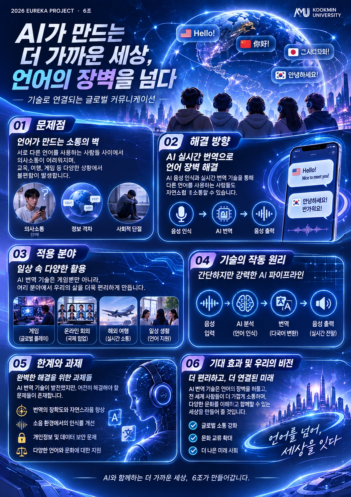

# Welcome to E26-SW02-06

## 🎯 팀 슬로건

> 목표 그 이상을 향해

## 🖼️ 팀 포스터

***

## 1️⃣ 팀원 소개

| **윤어진** | **소프트웨어학부** | 게임개발, 인디 |
| **유가준** | **소프트웨어전공** |  |
| **이건우** | **소프트웨어전공** | 여행, 스타트업 |
| **노신호** | **소프트웨어학부** |  |

2026-09-19 팀 재편으로 E26-SW02-11 팀(이건우·노신호)이 합류했고, 한지원·노현우는 E26-SW02-11로 이동했습니다.

***

## 2️⃣ 공통된 관심사 : 여행, 백엔드, 인공지능, 스타트업

***

## 3️⃣ 한학기 동안의 활동 내역 

***

## 4️⃣ 인상 깊은 활동

***

## 5️⃣ 특별히 알아보고 싶은 것

***

## 6️⃣ 활동을 마친 소감
